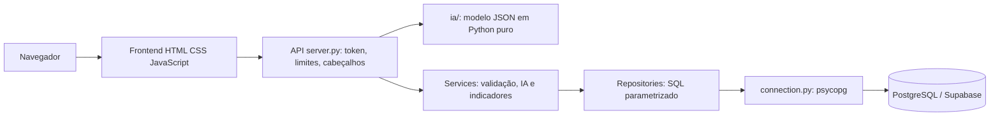

# Arquitetura e API

## Implementação atual

`rede-alimenta-back/server.py` serve as páginas do frontend (`/` início, `/admin` painel do gestor, `/doar`, `/ong`, `/privacidade`) e a API na mesma origem. O servidor usa `ThreadingHTTPServer` com timeout de 10 s, no máximo 64 conexões, limite de taxa por IP, cabeçalhos de segurança e autenticação obrigatória em `/api/*` (conta de gestor ou token da API; veja `security.py`, `services/autenticacao_service.py` e a matriz STRIDE). Escuta em `127.0.0.1:8000` por padrão (`HOST`/`PORT` configuram a nuvem). A documentação Swagger está em `/docs` e o contrato OpenAPI 3.0.3 em `/openapi.json`, gerado por `api_docs.py`. A autorização é por perfil: conta de gestor usa o painel, conta de ONG usa só o portal da própria ONG. A migração para FastAPI permanece como opção.

A página Swagger usa Swagger UI 5.33.1 vendorizado em `rede-alimenta-back/vendor/swagger-ui` (hashes em `SHA256SUMS`), sem CDN; o botão Authorize recebe o `API_TOKEN`. `Try it out` chama as rotas reais; criação, edição e exclusão afetam o banco configurado. Exemplos de IDs devem ser substituídos por registros existentes. Integração baseada na [documentação oficial Swagger UI](https://swagger.io/docs/open-source-tools/swagger-ui/usage/installation/).

`services/` valida entradas e existência de registros. `repositories/` executa consultas SQL parametrizadas, faz commit/rollback nas alterações e fecha conexões. `database/connection.py` carrega `DATABASE_URL` com `python-dotenv`.

## Modelo de dados observado

Campos abaixo vêm das consultas do código e do esquema versionado em `rede-alimenta-back/database/schema.sql` (conferido contra o banco Supabase da equipe: tipos, chaves estrangeiras com `ON DELETE CASCADE`, e-mail único e dois índices únicos parciais em `matches` que impedem reservar a mesma doação duas vezes). `python migrar.py` aplica o esquema e as migrações aditivas de `migracoes/` (links de acesso das ONGs, pedidos de acesso e CNPJ).

| Entidade | Campos usados |
|---|---|
| doadores | id, nome, email, telefone, regiao, latitude, longitude |
| ongs | id, nome, email, telefone, regiao, capacidade_kg, latitude, longitude, cnpj (opcional, único, só dígitos) |
| ong_links_acesso | ong_id, versao, atualizado_em (versão vigente do link de cada ONG) |
| ong_solicitacoes_acesso | id, nome, email, telefone, regiao, mensagem, cnpj, capacidade_kg, status (`pendente`, `atendida`, `descartada`), criado_em (descartar apaga os dados pessoais) |
| ofertas_publicas | id, codigo_hash (hash do código de acompanhamento), nome, email, telefone, regiao, alimento, categoria, quantidade_kg, validade, status (`pendente`, `aprovada`, `recusada`), doacao_id (preenchido na aprovação), criado_em, decidido_em (recusar apaga os dados pessoais) |
| match_confirmacoes | match_id, origem (`ong` ou `gestor`), confirmado_em |
| usuarios | id, perfil (`gestor` ou `ong`), ong_id (só para `ong`), nome, email (único sem diferença de caixa), senha_hash (PBKDF2), ativo, trocar_senha, criado_em, ultimo_acesso |
| usuario_sessoes | token_hash (SHA-256 do token), usuario_id, criado_em, expira_em |
| auditoria_acoes | id, quando, ator_tipo (`usuario`, `token`, `link`, `sistema`), ator_nome, acao, recurso, registro_id, ip (só em logins) |
| doacoes | id, doador_id, alimento, categoria, quantidade_kg, validade, status, data_cadastro |
| matches | id, doacao_id, ong_id, score_ia, prioridade, status, data_match |

Relações: doador → várias doações; doação → vários matches; ONG → vários matches (chaves estrangeiras reais). O banco da equipe também contém tabelas de outras frentes (contas de ONG e doador, sessões, notificações, auditoria) que **este código não usa**. As listagens de doadores e ONGs não retornam coordenadas.

## Contrato atual

Para cada recurso `doadores`, `ongs`, `doacoes` e `matches`:

| Método e rota | Operação | Resposta de sucesso |
|---|---|---|
| `GET /api/{recurso}` | Listar registros | 200, array de objetos |
| `POST /api/{recurso}` | Criar registro | 201, `{"id": 1}` |
| `PUT /api/{recurso}/{id}` | Editar campos permitidos | 200, `{"ok": true}` |
| `DELETE /api/{recurso}/{id}` | Excluir registro | 200, `{"ok": true}` |

Não existe consulta HTTP individual por ID. PUT requer os campos de edição, salvo os opcionais; não é atualização parcial. Requisições POST/PUT são lidas como JSON e limitadas a 65.536 bytes.

| Recurso | Campos de criação | Campos de edição |
|---|---|---|
| doadores | nome, email, telefone*, regiao, latitude*, longitude* | nome, telefone*, regiao |
| ongs | nome, email, telefone*, regiao, capacidade_kg, latitude*, longitude*, cnpj* | nome, telefone*, regiao, capacidade_kg, cnpj* (se omitido na edição, o CNPJ atual é mantido) |
| doacoes | doador_id, alimento, categoria*, quantidade_kg, validade | alimento, categoria*, quantidade_kg, validade, status |
| matches | doacao_id, ong_id, score_ia, prioridade | status |

`*` Opcional na API. Use números JSON para quantidades, score e IDs; validade em `AAAA-MM-DD`.

## Rotas públicas e do portal (sem o token do gestor)

| Método e rota | Quem usa | Operação |
|---|---|---|
| `POST /api/login` | Gestor ou pessoa de ONG | Com `email` e `senha`: login de conta (sessão de 12 h, token `u1…`); não há senha única. Erro uniforme; 5 falhas por e-mail em 15 min e 10 por IP por minuto bloqueiam |
| `GET /api/eu`, `POST /api/eu/senha`, `POST /api/logout` | Qualquer conta | Quem sou, trocar a própria senha (derruba as outras sessões) e sair; com senha provisória, são as únicas rotas liberadas |
| `POST /api/ong-portal/conta` | Pessoa da ONG com o link | Cria a própria conta (o link é o convite) e já devolve a sessão |
| `POST /api/publico/doacoes` | Qualquer pessoa | Envia uma oferta; ela fica em `ofertas_publicas` (sem criar doador nem doação) até o gestor decidir, e a resposta traz o código de acompanhamento |
| `POST /api/publico/acompanhar` | Doador | Em que etapa está a oferta, pelo código (no corpo, nunca na URL); só situação, alimento, quantidade e, depois do aceite, o nome da ONG |
| `POST /api/publico/ong-acesso` | ONG | Pede acesso ao portal (nome, e-mail, região, CNPJ e capacidade opcionais, aceite de privacidade); resposta sempre igual |
| `GET /api/ong-portal/matches` e `POST /api/ong-portal/matches/{id}/aceitar`, `recusar` ou `receber` | ONG (link com código nos cabeçalhos `X-Ong-Id` e `X-Ong-Codigo`) | Vê só os próprios matches, responde e confirma o recebimento do que aceitou (conclui a entrega); contato do doador só após o aceite |

Rotas do gestor adicionais (exigem token): `POST /api/doacoes/{id}/aprovar` ou `recusar`, `GET /api/ongs/{id}/link`, `POST /api/ongs/{id}/link/renovar` e `POST /api/ongs/{id}/link/desativar` (devolvem o caminho, a versão, `gerado_em`, vazio no link original, e `ativo`), `GET /api/usuarios` e `POST /api/usuarios` (cria a conta e devolve a senha provisória uma vez), `POST /api/usuarios/{id}/desativar`, `reativar` e `redefinir-senha`, `GET /api/auditoria`, `GET /api/ofertas` e `POST /api/ofertas/{id}/aprovar` ou `recusar` (aprovar cria o doador, ou reaproveita o do mesmo e-mail, e a doação disponível numa transação), `GET /api/ong-solicitacoes` e `POST /api/ong-solicitacoes/{id}/atender` ou `descartar`.

## IA e indicadores

| Método e rota | Operação |
|---|---|
| `POST /api/ia/risco` | Classifica o risco de descarte de um lote informado (corpo validado: textos até 200 caracteres, números finitos em faixas definidas); não acessa o banco |
| `GET /api/doacoes/{id}/recomendacoes` | Até 5 ONGs com capacidade suficiente, ordenadas por `score_ia` (empate: a mais perto); só para doações `disponivel`; retorna prioridade sugerida, a distância de cada ONG (`distancia_km`, `distancia_origem`: coordenadas, cidade ou estimativa) e não inclui e-mail/telefone |
| `GET /api/indicadores` | Kg salvos, refeições estimadas, oferta por região do doador, **entregas por região atendida (região da ONG) com posição no mapa**, lotes críticos, tempo médio de match (desde o envio da oferta), entregas confirmadas pela ONG ou pelo gestor, métricas da IA e Security Gates |

O modelo é uma regressão logística exportada para `ia/modelo_risco.json` e executada em Python puro (`ia/inferencia.py`): a API não depende de scikit-learn nem carrega pickle. `ml/tests/test_exportacao.py` confere que o JSON reproduz o pipeline scikit-learn. O `score_ia` da recomendação é `1 − (0,5·P(médio) + P(alto))` do risco de descarte para cada ONG. A distância é a linha reta (haversine, `services/geo.py`) entre as coordenadas do cadastro, ou entre os centros das cidades citadas na região (tabela de ~100 cidades), ou, quando nada disso existe, uma estimativa fixa (5 km na mesma região, 15 km em outra). O modelo só viu distâncias de até 25 km, capacidades de até ~200 kg e quantidades de até 120 kg: `ia/inferencia.py` leva valores fora da faixa do treino (`faixa_treino` em `modelo_risco.json`) ao limite dela e devolve `entradas_ajustadas`, para a regressão logística não extrapolar (antes disso, uma ONG com 2.000 kg de capacidade tinha score de ~100% só por extrapolação).

Regras de validação (faixas, formatos, validade por categoria, IA de alimento): veja o README. A edição de doação não repete a restrição de validade vencida. `score_ia` pode ser informado manualmente ou vir da recomendação por IA (botão "Recomendar ONG").

- Status de doação: `disponivel`, `reservada`, `concluida`, `cancelada`.
- Prioridade de match: `baixa`, `media`, `alta`.
- Status de match: `pendente`, `aceito`, `recusado`, `concluido`.

Erros são objetos `{"error": "mensagem"}`. Validação pode retornar 400; rota inexistente, 404; operação não suportada, 405; exceções não tratadas especificamente, 503. Uma `DATABASE_URL` ausente gera `ValueError` e pode retornar 400. Tipos malformados e erros do banco não têm classificação uniforme. Falta de registro também é tratada como 400 pelos services.

## Arquitetura prevista para completar o enunciado

**Diferença consciente em relação ao enunciado:** o PDF cita FastAPI e Streamlit/Gradio como stack sugerida. O projeto usa um servidor Python próprio (`http.server`, sem dependências além do `psycopg`), com documentação Swagger/OpenAPI própria, e um frontend HTML/CSS/JS servido na mesma origem. Justificativa: imagem Docker pequena (Alpine, 5 pacotes Python), superfície de ataque menor, CSP estrita sem scripts inline e três perfis de usuário (gestor, doador, ONG) que um painel Streamlit atenderia mal. O custo é manter à mão o que o FastAPI daria pronto (validação, rotas, OpenAPI); os critérios de qualidade, Swagger e segurança do enunciado são atendidos. Pendentes: migrar a camada HTTP para FastAPI se a banca exigir, ler coordenadas para distância real e rotas, autorização por usuário/instituição e observabilidade.
