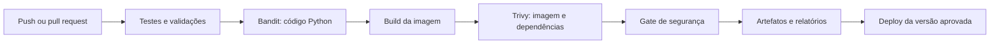

# DevSecOps e deploy

## Estado atual

Foram adicionados `Dockerfile`, `compose.yaml`, `.dockerignore`, exemplo de ambiente e workflow `.github/workflows/devsecops.yml`. O workflow valida sintaxe, inicialização do container e análises Bandit/Trivy com artefatos. Em 08/10/2026, o build e a execução locais foram validados com Docker Desktop e WSL 2: container saudável, frontend, saúde e OpenAPI respondendo HTTP 200, além das quatro rotas de listagem acessando o Supabase. O commit `df4e20c` também passou nos dois jobs do [workflow no GitHub](https://github.com/joaovitorxc/Alimenta-IA/actions/runs/37799988655). O serviço está publicado no Render em https://alimenta-ia.onrender.com (deploy manual, plano gratuito, banco no Supabase). O PDF solicita esses entregáveis nos checkpoints 2 e 3. O servidor atual usa `http.server` e não deve ser considerado um servidor de produção.

## Containerização proposta

- Criar imagem Python com versão definida, dependências reproduzíveis e usuário sem privilégios administrativos.
- Excluir `.env`, `.venv`, `.git`, caches e datasets sensíveis do contexto de build.
- Usar configuração por ambiente; não embutir `DATABASE_URL` na imagem.
- Criar Compose para aplicação e banco de desenvolvimento ou conexão externa configurável.
- Documentar portas, healthcheck, volumes, inicialização do schema e restauração.

Critério de aceite: outra pessoa consegue construir e iniciar o projeto seguindo a documentação, sem depender do ambiente virtual do autor. O build e a execução Docker foram validados localmente em 08/10/2026. O Compose conecta ao banco existente e não provisiona tabelas. Dependências Python já têm versão exata; a imagem base ainda precisa de digest fixo no `FROM` para reprodução estrita.

## Pipeline proposto

Executar CI em pull requests e na branch principal. Deploy deve usar apenas contexto confiável e versão aprovada, com credenciais de ambiente protegido. Bandit analisa código Python; Trivy complementa com análise de imagem/dependências e configuração conforme o modo escolhido.

Política implementada no workflow: Bandit bloqueia severidade média/alta com confiança média/alta; Trivy bloqueia vulnerabilidades altas/críticas identificadas na cobertura disponível. Não há exclusões de CVEs nem uso de `ignore-unfixed`. Falhas de sintaxe, build e smoke check também reprovam seus jobs. Relatórios são arquivados com `if: always()`. Deploy ainda não foi implementado. Exceções exigem justificativa, responsável e prazo no registro da equipe.

## Registro das análises

| Campo | Preenchimento obrigatório após executar |
|---|---|
| Ferramenta e versão | Bandit/Trivy e configuração usada |
| Referência | Commit e, para imagem, digest |
| Momento | Data/hora da análise |
| Resultado | Achados por severidade e decisão do gate |
| Tratamento | Correção, reexecução e justificativas de exceção |
| Evidência | Link do job e arquivo do relatório |

Execuções registradas em 08/10/2026:

| Commit e execução | Resultado | Tratamento |
|---|---|---|
| [`0e2a1b2`](https://github.com/joaovitorxc/Alimenta-IA/actions/runs/37797647546) | Bandit aprovado; teste HTTP recebeu conexão reiniciada durante a inicialização | Adicionada espera com repetição para erros transitórios de conexão |
| [`3cc58e7`](https://github.com/joaovitorxc/Alimenta-IA/actions/runs/37798513835) | Inicialização aprovada; Trivy bloqueou 44 ocorrências HIGH de 8 CVEs na base Debian, sem versão corrigida indicada | Substituída a base por Python 3.12 sobre Alpine 3.24 |
| [`df4e20c`](https://github.com/joaovitorxc/Alimenta-IA/actions/runs/37799988655) | Ambos os jobs aprovados | Mantidos os critérios de bloqueio; imagem validada também localmente com consultas de leitura ao Supabase |

Na execução aprovada, foram usados Python 3.12.15, Bandit 1.9.4 e Trivy 0.70.0. Os relatórios estão nos artefatos `bandit-df4e20c83a2be004fd77347db7206b2686a2b73e` e `trivy-df4e20c83a2be004fd77347db7206b2686a2b73e`. O arquivo `image.json` registra a imagem construída; a base usada foi `python:3.12-alpine3.24@sha256:1b668429b3511ab407d8e00648891631b0b1a4d7e15e3ca70f38ab5b91ad4ab4`.

A imagem corrigida contém `libuuid 2.42.3-r1` e `ncurses 6.6_p20260516-r0`, com correções dos CVEs anteriores, e não contém os pacotes ACL, Perl e systemd que geraram os demais achados. Referências: [correções Alpine](https://secdb.alpinelinux.org/v3.24/main.json) e [histórico ncurses](https://invisible-island.net/ncurses/NEWS.html).

O Trivy local identificou Alpine 3.24.2, 38 pacotes do sistema e 5 pacotes Python, sem achados HIGH/CRITICAL no relatório filtrado. A aprovação representa a cobertura e a base de vulnerabilidades disponíveis naquele momento. O scanner de pacotes [Alpine não cobre vulnerabilidades ainda sem correção](https://trivy.dev/docs/latest/coverage/os/alpine/); portanto, o resultado não afirma ausência total de vulnerabilidades. Novas alterações e atualizações da base de vulnerabilidades exigem nova análise.

## Endurecimento de segurança (14/10/2026)

Implementado no código e no workflow: autenticação Bearer obrigatória em `/api/*`, servidor com threads, timeouts e limites (conexões, taxa, falhas de autenticação), cabeçalhos de segurança com CSP, Swagger UI vendorizado (5.33.1, `sha256sum --check` no CI), dependências Python com versão exata, Actions fixadas por SHA e novos gates: testes de segurança, Bandit também em `ml/`, pip-audit, Gitleaks no histórico completo e Trivy com `vuln,secret,misconfig` na imagem e `config` no Dockerfile/Compose.

Verificado localmente em 14/10/2026 (antes do push; os resultados oficiais virão do GitHub Actions): 24 testes automatizados aprovados (23 da API, incluindo segurança, IA e indicadores, e 1 de equivalência do modelo); Bandit sem achados; pip-audit sem vulnerabilidades conhecidas (backend e `ml/`); Gitleaks sem vazamentos no histórico (10 commits) e nos arquivos novos ainda não commitados; Trivy `config` sem achados HIGH/CRITICAL; Trivy da imagem local (Alpine 3.24.2, 5 pacotes Python) sem achados HIGH/CRITICAL; container iniciou, `/health` respondeu 200, `/api/doadores` sem token respondeu 401 e a ausência de `API_TOKEN` impediu a inicialização. "Sem achados" refere-se à cobertura e à base de vulnerabilidades daquele momento, não a ausência total de vulnerabilidades.

Pendências: identidade por usuário e autorização por instituição, rate limit compartilhado entre instâncias, TLS/HSTS no provedor de deploy, proteção da branch `main` e digest fixo da imagem base.

## Publicação

Provedor escolhido: **Render** (Web Service Docker, plano gratuito), descrito em `render.yaml`, com `autoDeploy: false`: a publicação é manual, depois do pipeline verde. O servidor lê `HOST`/`PORT` do ambiente e `TRUST_PROXY=1` atrás do proxy do Render. Em 14/10/2026 a URL respondia 200 em `/`, `/health`, `/doar`, `/ong`, `/admin`, `/docs` e `/openapi.json`, e 401 em `/api/ongs` sem token. O plano gratuito suspende o serviço por inatividade: o primeiro acesso pode demorar cerca de 1 minuto (abrir a URL antes da apresentação).

Checklist de cada publicação: (1) pipeline verde; (2) deploy manual no Render; (3) conferir no log a linha "Banco atualizado": o servidor aplica sozinho o esquema e as migrações ao iniciar (`AUTO_MIGRAR=1`, aditivas e idempotentes, com limite de 5 s para obter travas e 60 s por arquivo; se falhar, o servidor sobe e registra o erro, e `python migrar.py` com a `DATABASE_URL` da nuvem resolve); (4) abrir `/health`, `/admin` e a página pública; (5) registrar commit e horário.

Configurar secrets, conexão protegida com banco, schema versionado, autenticação/autorização e logs sem informações sensíveis. Após deploy, validar acesso HTTPS, saúde, permissões, fluxo de doação e recuperação de falhas. Registrar URL, versão, provedor, responsável e procedimento de rollback.

Rollback proposto: promover a última imagem aprovada; alterações de banco exigem plano próprio de compatibilidade/restauração. Criar backup antes de operações destrutivas e comprovar restauração em ambiente de teste.

## Verificação final local (15/10/2026)

Executada antes do commit final, com `python ferramentas/gerar_seguranca.py` (o mesmo script grava `ia/seguranca.json`, que alimenta o quadro "Security Gates" do dashboard, com as versões e o commit-base). Os resultados oficiais continuam sendo os do GitHub Actions.

| Gate | Resultado local | Ferramenta |
|---|---|---|
| Testes automatizados da API | 212 aprovados (mais 1 de equivalência do modelo em `ml/tests`) | `unittest` |
| Bandit (backend e `ml/`) | **zero achados**, nem de severidade baixa | Bandit 1.9.4 |
| Dependências | sem vulnerabilidades conhecidas (backend e `ml/`) | pip-audit 2.10.1 |
| Segredos | sem vazamentos nos 19 commits do histórico (o `.env` local, ignorado pelo Git e excluído da imagem, é o único arquivo com segredos na pasta de trabalho) | Gitleaks v8.30.0 |
| Imagem do container | sem achados HIGH/CRITICAL (`vuln`, `secret`, `misconfig`) | Trivy 0.76.0 |
| Dockerfile e Compose | sem achados HIGH/CRITICAL | Trivy 0.76.0 |

A imagem reconstruída iniciou, `/health` e `/privacidade` responderam 200 e `/api/ongs` sem token respondeu 401. Durante o desenvolvimento, o Bandit apontou dois pontos do código novo (consultas SQL montadas por texto em `ong_repository.py` e `demo_seed.py`); foram trocados por consultas parametrizadas antes do commit. "Sem achados" refere-se à cobertura e à base de vulnerabilidades daquele momento, não a ausência total de vulnerabilidades. O quadro do dashboard é um retrato local datado, não uma leitura ao vivo do pipeline.
